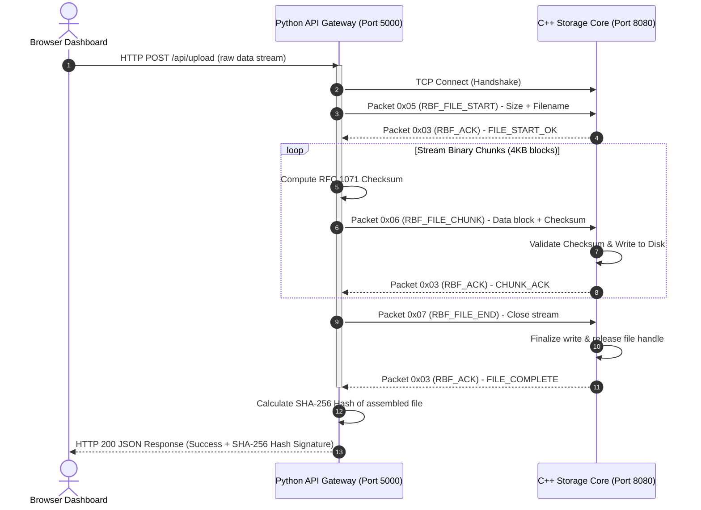

# AetherFlow: Distributed Binary Protocol & Storage Engine

AetherFlow is a production-grade, high-performance distributed systems platform implementing a custom **Reliable Binary File Transfer Protocol (RBFTP)**. The system is designed to simulate industrial IoT telemetry gateways, over-the-air (OTA) firmware deployment networks, and low-latency asset pipelines.

---

## ⚡ Recruiter & Engineer Quick Reference

> [!NOTE]
> **Why this project is relevant:**
> * **C++ Systems Engineering**: Thread isolation, Winsock2 socket layer abstraction, RFC 1071 internet checksum calculations.
> * **API Design**: HTTP-to-TCP socket protocol translation gateway in Python.
> * **Web Engineering**: Responsive glassmorphic frontend detailing live performance graphs and real-time console log telemetry.
> * **End-to-End Cryptographic Security**: Asynchronous SHA-256 file signature verification upon disk assembly.

### One-Click Launch (Start in 5 Seconds)
1. **Windows**: Double-click [**`start_platform.bat`**](file:///c:/Users/saath/Downloads/Saathvik_Resume/aetherflow/start_platform.bat) in your file explorer.
2. **Linux / macOS**: Open terminal and run:
   ```bash
   chmod +x start_platform.sh && ./start_platform.sh
   ```
This compiles the C++ binaries, clears conflicting socket ports, boots both core servers, and opens the **Visual Web Dashboard** directly in your browser.

---

## 🔮 System Architecture & Packet Flow

The diagram below details how the client dashboard and API Gateway translate web uploads into low-level binary TCP socket frames.



---

## 🛠️ Technical Specifications

### 1. Custom RBFTP Binary Header Layout
Every packet sent between the gateway and storage node consists of a strict **8-byte header** followed by a variable payload:

| Byte Offset | Field Name | Type | Description |
|---|---|---|---|
| `0 - 1` | Magic Bytes | `uint8_t[2]` | Fixed signature `0x51` `0x43` (ASCII `'Q'`, `'C'`) |
| `2` | Version | `uint8_t` | Currently `0x01` |
| `3` | Packet Type | `uint8_t` | Type ID (PING, DATA, FILE_START, etc.) |
| `4 - 5` | Payload Length | `uint16_t` | Size of payload data in Big-Endian |
| `6 - 7` | Checksum | `uint16_t` | 16-bit Internet Checksum of payload (RFC 1071) |

### 2. REST API Documentation (Web Gateway)

| Endpoint | Method | Payload | Response | Description |
|---|---|---|---|---|
| `/` | `GET` | *None* | `text/html` | Serves the glassmorphism visual dashboard. |
| `/api/metrics` | `GET` | *None* | `application/json` | Tail-logs diagnostics and outputs file count. |
| `/api/files` | `GET` | *None* | `application/json` | Lists uploaded files, sizes, and **SHA-256 signatures**. |
| `/api/ping` | `POST` | *None* | `application/json` | Triggers a latency check to the C++ Core Node. |
| `/api/upload` | `POST` | `binary` | `application/json` | Uploads file. Translates HTTP stream to TCP RBFTP. |

---

## 💻 Manual Developer Guide

### Command Line Interactive CLI (Alternative client)
If you prefer not to use the web application, a terminal client CLI is available:

**Build binaries manually:**
```bash
g++ -std=c++11 -Wall -O2 src/server.cpp src/packet.cpp -o server.exe -lws2_32
g++ -std=c++11 -Wall -O2 src/client.cpp src/packet.cpp -o client.exe -lws2_32
```

**Run Interactive Client:**
```bash
./client.exe
```
Exposes an interactive prompt (`RBFTP> `) with system commands:
* `ping` - Measure network round-trip time.
* `send <filepath>` - Stream a local file with a dynamic visual progress bar.
* `help` - View commands list.
* `exit` - Terminate socket session cleanly.
